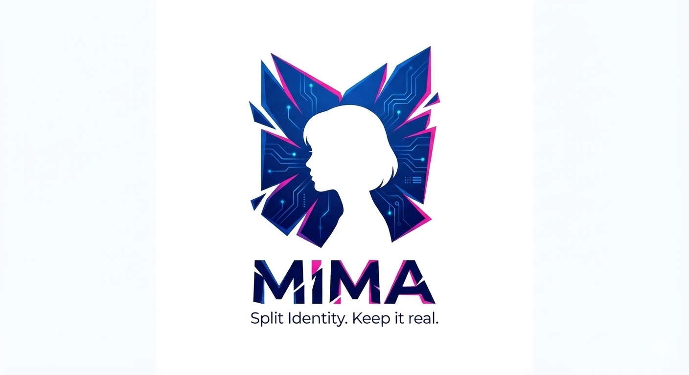

# mima

<p align="center">
  
</p>

**A Keychain-backed environment manager for macOS.** Group API keys, database URLs, and other secrets; inject one group into a child process with a single Touch ID prompt. Useful today for scoping what an AI coding agent can see, or running commands with project-specific credentials. On the roadmap: a shell hook with per-project `.mima.yaml` discovery, at which point mima becomes a full `direnv` replacement with Keychain-backed values.

---

## Status

Alpha. What works today:

- `mima secret` — add / list / get / remove secrets in the macOS Keychain with a `.userPresence` ACL
- `mima group` — map environment-variable names to secret names, organised into groups (`~/.mima.yaml`)
- `mima run <group> -- cmd` — one Touch ID unlocks the whole group; secrets are injected into the child via `execve`, never into the parent `environ`
- `mima env <group>` — print shell `export` lines for `eval "$(...)"` in an interactive shell

Not yet (see [Roadmap](#roadmap)):

- Shell hook (`mima hook zsh|bash|fish`) with per-project `.mima.yaml` discovery — three loading modes (wrapper / public-env / compat), see [Threat model](#threat-model)
- `mima run --scrub` for aggressively-scoped agent sandboxing
- Session agent so Touch ID amortises across a shell session instead of firing on every prompt
- `direnv allow`-style trust model, flake integration, `.env` loader, `PATH_add`

## Agent sandboxing

This is mima's sharpest use today. Local coding agents — Claude Code, aider, codex, cursor — run under your shell and inherit your full `environ` by default. If you've ever `export`ed a prod AWS key, a personal GitHub token, or a billing-capable Stripe key, the agent can see all of it, and it can shell out. mima's per-group model is the intervention: each agent gets one group containing only what it needs.

```bash
mima group link agent-claude GITHUB_TOKEN      gh-agent-readonly
mima group link agent-claude ANTHROPIC_API_KEY anthropic-key
mima run agent-claude -- claude-code

mima group link agent-aider OPENAI_API_KEY     openai-key
mima run agent-aider -- aider
```

Delete the group when you're done with a project; the underlying secret stays in the Keychain for reuse elsewhere.

> **Why not `env -i`?**
> `env -i cmd` scrubs the inherited env — correct, but it doesn't give you any way to re-inject the scoped values the agent actually needs. mima is the "where do those values come from" half: Keychain-stored, biometric-gated, declared as a group. `mima run --scrub` (see [Roadmap](#roadmap)) will combine both: strip the parent env, inject only the group, keep a minimal safelist like `PATH`, `HOME`, `TERM`.

## Install

```bash
git clone https://github.com/klobucar/mima.git
cd mima
make install
```

The Makefile codesigns the binary against `entitlements.plist` — that's what lets it talk to the Keychain at all.

By default, ad-hoc signing is used and mima falls back to a non-ACL Keychain item. Still encrypted at rest, but no Touch ID gate.

To enable biometric unlock, sign with your own Apple Developer identity (find it in Keychain Access, e.g. `Apple Development: Name (TEAMID)`):

```bash
make install SIGNING_IDENTITY="Apple Development: Name (TEAMID)"
```

## Quick start

```bash
# Stash secrets in the Keychain
mima secret add openai-key          # prompts for value securely
mima secret add anthropic-key

# Map env-var names to secret names, under a group
mima group link agent OPENAI_API_KEY openai-key
mima group link agent ANTHROPIC_API_KEY anthropic-key

# Run a command with just that group's env
mima run agent -- claude-code
```

One Touch ID prompt. `claude-code` starts with `OPENAI_API_KEY` and `ANTHROPIC_API_KEY` set. Nothing else from your shell leaks in, and your parent shell's `environ` is never touched.

## Commands

### `mima secret`

```bash
mima secret add <name>              # prompt securely (getpass)
mima secret add <name> <value>      # inline — avoid, goes into shell history
mima secret rm <name>
mima secret list                    # names only, no values
mima secret get <name>              # print value; warns to stderr
mima secret get <name> --export     # print `export NAME=VALUE`
```

### `mima group`

```bash
mima group link <group> <ENV_VAR> <secret-name>
mima group list
```

Mappings are stored in `~/.mima.yaml`, written atomically:

```yaml
groups:
  agent:
    OPENAI_API_KEY: openai-key
    ANTHROPIC_API_KEY: anthropic-key
  dev:
    DATABASE_URL: dev-db
    STRIPE_KEY: stripe-test
```

### `mima run`

```bash
mima run <group> -- <command> [args...]
```

Unlocks the group's secrets behind a single `LAContext`, then `execve`s the command with an explicit envp built from your current env plus the group's values. The parent `mima` process never calls `setenv`.

### `mima env`

```bash
eval "$(mima env <group>)"
```

Prints shell `export` lines. Less private than `mima run` because values land in your interactive shell, but useful when you need secrets for multiple ad-hoc commands. Output is POSIX-single-quote-escaped, so apostrophes and shell metacharacters cannot break the quoting.

## Other use cases

### Project-scoped secrets without a plaintext `.envrc`

Instead of:

```bash
# .envrc (gitignored, hopefully)
export STRIPE_KEY="sk_live_..."
export DATABASE_URL="postgres://..."
```

…store values once in the Keychain and reference them by name in `~/.mima.yaml`:

```yaml
groups:
  my-saas:
    STRIPE_KEY: stripe-prod
    DATABASE_URL: saas-db-url
```

For now, run commands via `mima run my-saas -- cmd`. Once the shell hook ships, the group will load automatically when you `cd` into a project with a matching `.mima.yaml`.

### Swap environments without reloading your shell

```bash
mima run staging -- ./deploy.sh
mima run prod    -- ./deploy.sh
```

## Security model

- Secrets are stored via `SecItemAdd` with `kSecAttrAccessControl = .userPresence`, so retrieval requires biometric or passcode authentication.
- One `LAContext` is reused for batch reads in `mima run`, so a single authorisation unlocks N secrets.
- `mima run` uses `execve` with an explicit envp. The parent process never calls `setenv`, so secrets do not appear in the parent's `environ`.
- `mima env` prints secrets to stdout and is inherently less private — use it deliberately. Output is POSIX-escaped against quoting attacks.
- mima cannot protect against a malicious child process. Once the child has the env var, it has the env var. Scope groups narrowly; prefer `mima run` over `mima env` when you can.
- mima does not manage SSH keys. Use [Paprika](https://github.com/klobucar/paprika) or an equivalent Secure-Enclave SSH agent for those. mima's scope is environment variables only.

## Threat model

mima's design is shaped by the class of attacks that dominates 2023–2025: **supply-chain credential stealers**. Shai-Hulud (npm, 2024), recurring PyPI token-stealer waves, compromised IDE extensions, malicious CLI tools from `curl | sh` installers, and prompt-injected agent commands. They all share a pattern: attacker code executes *as you*, during a routine action (package install, extension load, tool invocation). macOS's permission layer doesn't stop a process running as your user from reading anything else you can read. What saves you is what isn't accessible — values that aren't at rest, and values gated behind a prompt you'd notice.

### What mima defends against

- **Plaintext credential files.** `.env` / `.envrc` / `~/.aws/credentials` / `~/.npmrc` are readable by any process running as you, and the common scraper pattern is to read them directly. mima stores values in the Keychain behind a `.userPresence` ACL — retrieval requires a Touch ID prompt. An attacker trying to steal values triggers a biometric prompt out of nowhere, which is extremely conspicuous.
- **Globally-exported shell env.** If `.zshenv` runs `export STRIPE_KEY=…`, every process you launch — including every transitive postinstall script — inherits it forever. `mima run` scopes values to the specific child process you named; they never enter the parent shell's `environ`.
- **Secrets in shell history.** `mima secret add` uses `getpass`, never command-line arguments. Values never land in `.zsh_history`.
- **Over-broad agent access.** Coding agents inherit your full shell env by default. `mima run agent-claude -- claude-code` hands the agent only the variables you explicitly grouped for it.

### What mima does not defend against

- **Malicious children leaking the env they received.** Once the child has the variable, it can send it anywhere. Defense is narrow groups + sandboxing (devcontainer, firejail, macOS app sandbox).
- **Deceptive Touch ID prompts.** An attacker who can invoke the mima binary can trigger a legitimate biometric prompt. User vigilance is the only thing stopping a reflexive approval.
- **Shell-level compromise.** If your `.zshrc`, a shell plugin, or a supply-chain-compromised tool has injected code into your shell, mima runs inside that trust boundary and can't help.
- **Session agent TTL window.** When the session agent ships, unlocked values will sit in memory for a configurable interval. During that window, a supply-chain attacker running as you can read them without triggering a biometric prompt — the same class of risk `ssh-agent` and `op` accept. Short TTLs mitigate; they do not eliminate.
- **`mima env` + `eval`.** After you eval the output, values are in the shell `environ` for the rest of the session. Same threat surface as plain `export`. Use deliberately.

### Shell-loading modes

Supply-chain attacks shape how the shell hook works. A direnv-style auto-export on every `cd` would defeat mima's best property — putting group secrets into your shell `environ` so that any subsequent `npm install` or `pip install` inherits them. To keep secrets process-scoped by default while still offering direnv ergonomics, the hook supports three modes:

- **Wrapper mode (default).** `mima hook zsh` defines per-group shell functions when you enter a project. `dev` and `agent-claude` become functions that expand to `mima run <group> -- "$@"`. Every invocation is still `execve`-scoped; secrets never enter the shell `environ`. Touch ID fires per-command — amortised by the session agent once that lands.
- **Public-env mode.** `.mima.yaml` may declare an `env:` section for non-secret values (PATH additions, tool versions, nix/flake outputs). The hook auto-exports that section on `cd`; `groups:` (Keychain-backed secrets) stay behind `mima run`. Mirrors the nix-direnv pattern.
- **Compat mode (opt-in).** `auto_export: true` in `.mima.yaml` restores direnv-classic UX: groups auto-export on `cd`, unset on leave. Strictly weaker than wrapper mode against supply-chain attacks — any subsequent process in the shell inherits the secrets — but still an improvement over globally-exported `.zshenv`, because blast radius is scoped to one project at a time. Opt-in because the tradeoff should be conscious.

### Out of scope

mima raises the cost of credential theft; it doesn't prevent it. Not in scope: `curl | sh` review, phishing, MDM compromise, device theft with a weak passcode, or a persistent determined adversary with ongoing local code execution.

## Roadmap

1. **Shell hook + directory discovery.** `mima hook zsh` emits a precmd that discovers the nearest `.mima.yaml` by walking upward from `pwd`. Three loading modes:
   - **Wrapper mode** (default) — define per-group shell functions that expand to `mima run <group> -- "$@"`. Secrets stay process-scoped.
   - **Public-env mode** — auto-export a declared non-secret `env:` section; groups stay behind `mima run`.
   - **Compat mode** — auto-export groups on `cd` / unset on leave, direnv-classic. Opt-in via `auto_export: true` in `.mima.yaml`.

   See [Threat model](#threat-model) for why wrapper mode is the default.
2. **Agent sandbox flag.** `mima run --scrub <group> -- cmd` runs the child with *only* the group's env plus a minimal safelist (`PATH`, `HOME`, `TERM`, `USER`, `SHELL`) — the companion to [Agent sandboxing](#agent-sandboxing) above.
3. **Trust model.** `mima allow` / `mima deny` stores a content hash per config file, refusing to auto-load untrusted ones — same idea as `direnv allow`.
4. **Session agent.** A small launchd daemon holds unlocked values in memory keyed to a shell session so Touch ID amortises across a work session rather than firing on every `cd`.
5. **Nix / flake integration.** `use flake` shells out to `nix print-dev-env --json`, caches by flake-lock hash, merges into the exported env.
6. **Dotenv + `PATH_add`.** Cover the direnv use cases that don't need Keychain.

## Related

**Paprika** ([github.com/klobucar/paprika](https://github.com/klobucar/paprika)) is a Secure-Enclave SSH agent by the same author. Paprika handles SSH identity via `SSH_AUTH_SOCK`; mima handles everything else your shell exports. Together they cover the Touch-ID-gated-secrets surface of a dev shell, but either works standalone.

## License

MIT
